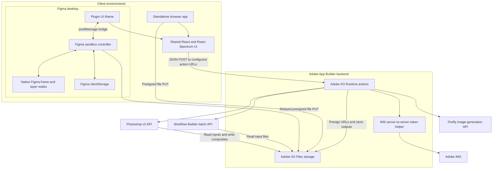
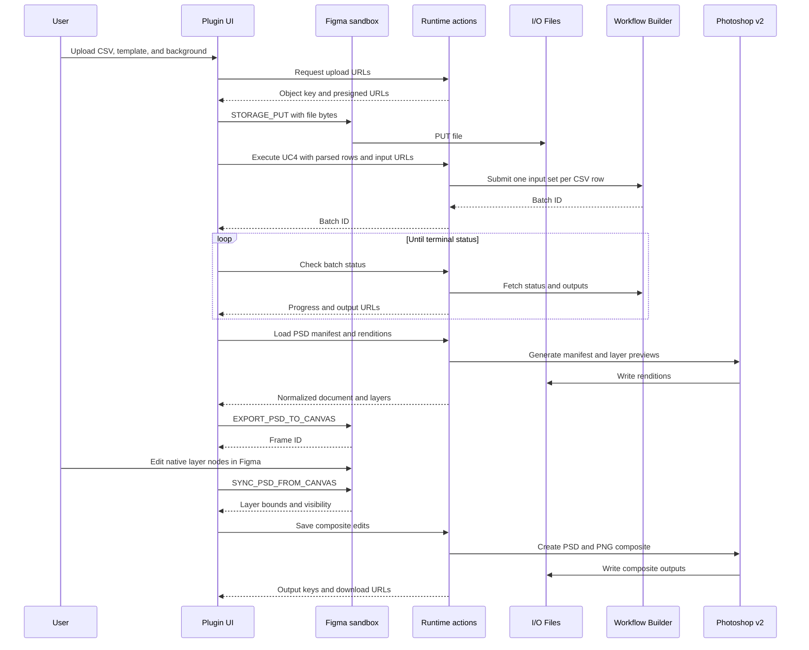

# Ulta Beauty Workflow Automation

Figma plugin and Adobe App Builder application for Ulta creative-production workflows: **UC1 SKU Compilation**, **UC4 SKU Personalization**, and **UC2B Banner Generation**. Both UI builds share a React 18 / Adobe React Spectrum application. Adobe I/O Runtime actions handle Workflow Builder, Photoshop, Firefly, authentication, and file storage.

## Contents

- [Figma Plugin](#figma-plugin)
- [Prerequisites](#prerequisites)
- [Local Setup](#local-setup)
- [Architecture](#architecture)
- [Workflows and Input Formats](#workflows-and-input-formats)
- [Configuration](#configuration)
- [Default Assets](#default-assets)
- [Runtime Actions](#runtime-actions)
- [Project Layout](#project-layout)
- [Build, Test, and Deploy](#build-test-and-deploy)
- [Security and Operational Notes](#security-and-operational-notes)
- [Troubleshooting](#troubleshooting)

## Figma Plugin

### Build and Import

Run these commands from this directory after completing [Local Setup](#local-setup):

```powershell
npm ci
npm run figma:build
```

The build creates the following files under `figma-plugin/dist/`:

| Artifact | Purpose |
| --- | --- |
| `code.js` | Figma sandbox controller: window sizing, upload relay, client storage, and native canvas operations. |
| `ui.html` | Self-contained UI with its JavaScript inlined for Figma. |
| `ui.js` | Compiled UI bundle used when generating the HTML. |

In the Figma desktop app:

1. Open a Figma design file.
2. Open **Plugins > Development > Import plugin from manifest**. The exact menu location can vary by Figma version.
3. Select [figma-plugin/manifest.json](figma-plugin/manifest.json).
4. Run **Ulta Beauty - Batch Workflow Automation** from the development plugins menu. The registered name uses a typographic dash in Figma.

Import the source manifest, not a file inside the generated `dist` directory. Its `main` and `ui` entries point to the generated files. The manifest currently contains a placeholder plugin ID; use the ID assigned by Figma when registering/publishing a plugin. This repository does not automate plugin publication.

**Building the plugin does not start or deploy its backend.** The UI calls the action URLs in [web-src/src/config.json](web-src/src/config.json). Start the local backend or configure reachable deployed actions before using uploads and workflows.

### Local Plugin Development

Use two terminals, both in this directory:

```powershell
# Terminal 1: local App Builder UI and action development
npm run dev
```

```powershell
# Terminal 2: continuously rebuild the Figma plugin
npm run figma:watch
```

When using local HTTPS endpoints, first open the local URL printed by the CLI in a browser and trust the development certificate as appropriate for your machine. Confirm the action map targets that backend, then run the plugin in Figma. Restart the plugin after a rebuild to load the new sandbox/UI code; the webpack watcher rebuilds files but does not hot-reload a running Figma plugin.

For a production-mode rebuild:

```powershell
npm run figma:build
```

For a plugin backed by deployed actions, deploy/configure those actions, verify the endpoint map, then rebuild the plugin. Endpoint URLs are compiled into the bundle; changing the JSON without rebuilding will not update an already built plugin.

The manifest allows Adobe static/CDN and Azure storage hosts, plus `https://localhost:9080` for development. If you change endpoint or asset hosts, review `networkAccess.allowedDomains` and `devAllowedDomains` in the manifest. Network permissions and storage CORS are separate concerns.

### Plugin Window and Zoom

- The initial plugin window is **1400 x 900**.
- Whole-plugin UI zoom starts at **80%**, changes in **10%** steps, and supports **50-150%**. The reset control returns to **100%**. This setting is initialized on each plugin launch, not saved as a preference.
- The bottom-right resize handle changes the window size, with a **400 x 300** minimum. Window resizing is separate from UI zoom.
- Whole-plugin zoom is separate from Figma's own canvas zoom and the standalone web editor's PSD canvas zoom.
- The theme control switches between light and dark mode.

### UC4: Edit a Workflow PSD in Figma

1. Select **UC4 SKU Personalization**.
2. Upload a valid UC4 CSV and a template PSD. Generate a background with Firefly or upload a background image; the current submission handler requires a background image even though the UI labels that input optional. Set the fallback canvas color as needed.
3. Run the workflow and wait for its output PSDs. New batches are inserted ahead of older open PSDs, preserving the order within each batch.
4. Select a generated PSD. The application loads its Photoshop manifest and layer renditions.
5. Click **Export to Figma Canvas**. The sandbox creates a frame at the PSD's document dimensions and places its leaf layers as image-filled rectangles.
6. Move, resize, rotate, and change layer visibility using Figma's native tools and layers panel.
7. Click **Sync from Canvas & Save**. The plugin reads the exported nodes' geometry and visibility, then requests a PSD/PNG composite from Photoshop.
8. Optionally click **Harmonize** after saving. Preview and download the available composite or harmonized outputs.

The native frame is an editable rendition-based representation, not a full Photoshop document importer. Text, smart objects, effects, and other Photoshop-specific structures are not recreated as equivalent Figma objects. Groups are not exported as duplicate image layers; the background is placed for reference and locked. Group/background transforms are excluded from composite edits. Sync uses the exported nodes' stored layer IDs; arbitrary newly created Figma nodes are not new PSD layers.

The web app uses the in-panel DOM layer editor instead of the native Figma export/sync path. Do not assume both builds expose identical editing controls.

### Session Storage

The plugin uses `figma.clientStorage` via the sandbox bridge for UC4 workflow/editor state and recent output links. The web app uses browser `localStorage`. Stored state can include uploaded object keys, batch IDs, layer edits, and output URLs; it is not an archival copy of PSD file bytes. UC4 can resume polling a saved running batch and reload manifests when restoring documents. The native frame connection is not serialized with the editor session, so export again when a restored PSD has no connected frame.

Opening the generated HTML as a regular file is not a substitute for running the plugin: its startup expects a Figma sandbox response for client storage. Use the standalone web app for browser-only development.

## Prerequisites

| Requirement | Notes |
| --- | --- |
| Node.js | Use **Node 24.11+** or **Node 22.18+** for the local build toolchain. Babel 8 requires these versions; older Node 20 installations cannot build the current UI dependency set. |
| npm | Use the committed lockfile with `npm ci`. |
| Adobe I/O CLI | The `aio` command and App Builder app commands must be available. |
| Adobe Developer Console workspace | An App Builder/Runtime workspace with Adobe I/O Files access and appropriate Adobe API entitlements. |
| OAuth Server-to-Server credential | Access to the target Workflow Builder graphs, Photoshop API, and Firefly/custom model as applicable. |
| Figma desktop app | Needed to import and run the local development plugin. |
| Templates and sample data | Valid PSD templates and CSVs matching the relevant workflow graph. Default assets are described below. |

The **local Node version** is distinct from the configured **Runtime action version**, which is `nodejs:20` in [app.config.yaml](app.config.yaml).

## Local Setup

The examples below use PowerShell. From the parent repository folder:

```powershell
Set-Location ulta_uc-wfb
npm ci
```

Install the Adobe CLI if it is not already available, authenticate, and associate this checkout with your own Developer Console workspace:

```powershell
npm install -g @adobe/aio-cli
aio login
aio app use "C:\secure\developer-console.json" --merge --no-service-sync
```

Download the Console configuration for the intended project/workspace and replace the example path. `--merge` preserves existing local configuration while importing; review the resulting workspace and credentials before running or deploying. Do not use another developer's `.aio` or secret files. Check `aio app --help` if the installed CLI lacks App Builder commands.

Create the application environment file only if one does not already exist:

```powershell
if (-not (Test-Path .env)) {
  Copy-Item .env.example .env
}
```

Fill in the values described in [Configuration](#configuration). Console imports may supply some standard values, but the custom names consumed by this application still need to be mapped. The workflow and node IDs in [.env.example](.env.example) are examples for the existing graphs, not portable settings for every workspace.

### Standalone Browser App

```powershell
npm run dev
```

This runs `aio app dev` through the repository's retry wrapper. Use the URL printed by the CLI, normally **https://localhost:9080**. Browser views use hash routes:

| Route | View |
| --- | --- |
| `/` | UC1 SKU Compilation |
| `/#/uc4` | UC4 SKU Personalization |
| `/#/uc2b` | UC2B Banner Generation |

Hash routes allow direct navigation without requiring server-side SPA path rewrites.

**Port handling:** `npm run dev` first runs a script that terminates processes listening on ports **9080** and **35729**. Do not run it while unrelated services on those ports must remain alive. The dev runner retries port-conflict failures up to five times.

For remote Runtime execution with local UI development:

```powershell
npm run run
```

This invokes `aio app run`. Prefer this mode when validating Runtime-managed services such as Files storage or behavior that is not faithfully reproduced by local action execution. Local development still uses Adobe APIs and workspace resources; it is not an offline mock environment.

## Architecture

### Components and Trust Boundaries



- [web-src/src/components/App.js](web-src/src/components/App.js) owns the shared app shell, theme, and feature selection.
- [figma-plugin/src/ui/index.js](figma-plugin/src/ui/index.js) marks the Figma environment, initializes plugin storage, and renders the shared app.
- [figma-plugin/src/plugin/controller.js](figma-plugin/src/plugin/controller.js) owns Figma APIs, storage upload relay, client storage, and native frame export/sync.
- [web-src/src/services/figmaBridge.js](web-src/src/services/figmaBridge.js) correlates sandbox requests and replies by `requestId`. Its default timeout is 120 seconds; PSD canvas export allows 300 seconds.
- [web-src/src/api.js](web-src/src/api.js) resolves the `ulta-wfb/<action>` endpoint map and sends JSON POST requests.
- [actions/libs/imsAuth.js](actions/libs/imsAuth.js) obtains and caches IMS access tokens in a warm action container, refreshing before expiry. Secrets remain server-side.
- [actions/libs/storage.js](actions/libs/storage.js) uses Adobe I/O Files, with four-hour read/write presigned URLs and Runtime-provided storage identity. No separate S3 bucket is required.

Figma's UI iframe has an opaque origin that can be rejected by storage CORS. Upload bytes are therefore relayed through the sandbox rather than sent directly from that iframe. Browser uploads use direct PUTs. Workflow payloads can use the provider label `AWS` for file inputs even though this application's upload store is Adobe I/O Files; that label is part of the upstream request contract, not evidence of an external bucket.

### UC4 Request Lifecycle



## Workflows and Input Formats

### UC1: SKU Compilation

Upload a CSV, use the primary PSD template and six additional templates, preview the request, and execute the configured Workflow Builder graph. Each CSV row becomes a batch input set. The UI displays execution status and the configured PSD/PNG output nodes; batch-history views can inspect previous batches and cancel a batch.

The required CSV headers are:

| Header | Purpose |
| --- | --- |
| `Sku's for Image` | SKU/content prompt input. |
| `Amplience Image Name` | Output filename input. |
| `Firefly \| Background` | Background-color selection input. |
| `Firefly \| Template` | Template/size selection input. |

Header matching is trimmed and case-insensitive; whitespace around `|` is normalized. The row parser supports comma-containing quoted fields and escaped double quotes, but splits input by physical lines, so do not put multiline field values in these CSVs. Use values accepted by your Workflow Builder graph; the frontend header checks are not a complete validation of graph-specific values.

UC1's additional template order is significant: the six template URLs are zipped to `WORKFLOW_ADDITIONAL_TEMPLATE_NODE_IDS` by index. Keep the UI template order and configured node order aligned.

### UC4: SKU Personalization

UC4 takes parsed CSV rows, one PSD template, a generated/uploaded background image, and a fallback hex color (default `#FFFFFF`). Each CSV row produces one workflow input set. The row's SKU list becomes comma-separated Ulta product image URLs of the form `https://media.ultainc.com/i/ulta/<sku>`; the `Size` value is sent as text, as supplied by the CSV. The backend currently sends these URLs as text, not individually rehosted files.

| Column | Requirement |
| --- | --- |
| `Image \| Sku` | Required SKU list. Also accepts `sku`, `skus`, `sku's`, `sku id`, or `sku ids`, with case/whitespace normalization. |
| `Size` | Required. Values must be accepted by the target graph. |
| `Name` | Optional output label. Also accepts `offer name`, `offer`, or `title`. |

For example, a two-SKU CSV cell must be quoted: `"1234567,2345678"`. All-empty rows are dropped. The same line-based CSV limitation described for UC1 applies.

The default Firefly prompt is:

> five geometric shapes composed of cylindrical and rectangular forms arranged in staggered positions on a flat surface with soft gradients in the background

Background generation uses Firefly's asynchronous v4 image endpoint, the configured Ulta custom model, Image 5 settings, one variation, a 4:3 aspect ratio, and 2.4MP resolution. The prompt is editable and limited server-side to 1,500 characters. The custom-model identifier is a backend constant in [actions/libs/firefly.js](actions/libs/firefly.js), not an environment variable. Your credential must be entitled to use it. The result is polled and made available as a background input.

UC4 polls workflow status at four-second intervals and extracts PSDs from `UC4_OUTPUT_PSD_NODE_IDS`. It restores saved workflow/editor state and inserts newly completed batches ahead of older open documents. Editing and saving are separate from the graph execution: native Figma geometry or web editor bounds are submitted to `psd-composite` against the original PSD.

**Harmonization:** the saved PSD is processed by the bundled [photoshop-action/Harmonization_Process V2.atn](photoshop-action/Harmonization_Process%20V2.atn), using the Photoshop action named `Harmonize Products`. The backend then renders PSD and PNG outputs. The ATN is included in the deployed action bundle by the configuration; this is not a Workflow Builder harmonization graph. Saving further edits invalidates the previous harmonized result.

### UC2B: Banner Generation

Upload a CSV and a banner template PSD, preview the payload if needed, then run the banner workflow. Unlike UC1/UC4, the application sends the **whole CSV file** as a single Workflow Builder input. CSV parsing and banner generation happen inside that graph; there is one submitted input set, not one per CSV row in this application.

The UI extracts available PSD/PNG outputs for preview/download. `UC2B_OUTPUT_NODE_IDS` is currently empty, so extraction scans all returned nodes for matching assets instead of restricting itself to known final nodes. Pin the final node IDs after validating a completed run; until then, output filtering depends on the response and may include non-final assets.

## Configuration

### Backend Environment Variables

Use [.env.example](.env.example) as the template and [app.config.yaml](app.config.yaml) as the source of truth for which variables are injected into each action. Keep secrets out of frontend files, plugin manifests, screenshots, and commits.

| Variable(s) | Purpose |
| --- | --- |
| `LOG_LEVEL` | Logging level where mapped by the configuration; several actions explicitly use `info`. |
| `IMS_OAUTH_S2S_CLIENT_ID` | OAuth Server-to-Server client ID; also the Photoshop API key used by the v2 client. |
| `IMS_OAUTH_S2S_CLIENT_SECRET` | Server-side client secret. |
| `IMS_OAUTH_S2S_ORG_ID` | Adobe IMS organization for Workflow Builder requests. |
| `IMS_OAUTH_S2S_SCOPES` | Credential's scopes, as a JSON-array string or comma-separated string accepted by the token helper. Use the scopes and service entitlements for your credential. |
| `IMS_USER_ID` | Technical account ID matching the bearer token identity, not a human user ID. |
| `API_KEY` | API key used by Workflow Builder and Firefly. Photoshop v2 uses `IMS_OAUTH_S2S_CLIENT_ID` instead. |
| `WORKFLOW_ID` | UC1 workflow graph ID. |
| `WORKFLOW_TEMPLATE_NODE_ID` | UC1 primary-template input node. |
| `WORKFLOW_ADDITIONAL_TEMPLATE_NODE_IDS` | Six comma-separated UC1 template input node IDs, in UI template order. |
| `WORKFLOW_SKU_NODE_ID`, `WORKFLOW_FILENAME_NODE_ID`, `WORKFLOW_BACKGROUND_NODE_ID`, `WORKFLOW_TEMPLATE_SIZE_NODE_ID` | UC1 per-row text input nodes. |
| `UC4_WORKFLOW_ID` | UC4 workflow graph ID. |
| `UC4_INPUT_IMAGE_NODE_ID` | UC4 PSD template input. |
| `UC4_INPUT_ROW_IMAGE_NODE_ID` | UC4 background-image input. |
| `UC4_INPUT_COLOR_NODE_ID`, `UC4_INPUT_SKU_URLS_NODE_ID`, `UC4_INPUT_SIZE_NODE_ID` | UC4 color, product-image-URL list, and size text inputs. |
| `UC2B_WORKFLOW_ID` | Banner workflow graph ID. |
| `UC2B_INPUT_CSV_NODE_ID`, `UC2B_INPUT_TEMPLATE_NODE_ID` | Banner CSV-file and PSD-template inputs. |

Storage uses Runtime identity supplied to `@adobe/aio-lib-files`; do not add external AWS credentials just because Workflow Builder payloads use `storageType: 'AWS'`. A valid local/remote App Builder storage context is still required.

### Frontend and Plugin Configuration

| File | Configuration |
| --- | --- |
| [web-src/src/config.json](web-src/src/config.json) | Action-name-to-URL map. The current checkout targets local HTTPS actions; verify every endpoint when switching environments. |
| [web-src/src/workflowConfig.js](web-src/src/workflowConfig.js) | Display name and UC1/UC4/UC2B output-node IDs. These are structural IDs, not secrets. |
| [figma-plugin/manifest.json](figma-plugin/manifest.json) | Plugin identity, entry points, editor type, and network permissions. |
| [figma-plugin/webpack.config.js](figma-plugin/webpack.config.js) | Plugin compilation, CSS injection, inline HTML bundle, and sandbox entry. |
| [web-src/src/components/Header.js](web-src/src/components/Header.js) | Tabs and whole-plugin zoom defaults. |

When a graph changes, update both its backend input-node configuration and its frontend output-node configuration. The display-only payload/cURL previews do not execute a workflow and do not expose secret authentication headers.

## Default Assets

UC1's default templates must be seeded into each target Files namespace. The seed script also provisions a UC4 background asset, but the current UC4 run still requires an explicitly selected generated/uploaded background image.

Run the script once per namespace against a running local backend or a deployed action base URL:

```powershell
# Local backend; defaults to https://localhost:9080/api/v1/web/ulta-wfb
node scripts/seed-default-assets.js
```

```powershell
# Deployed workspace; replace the namespace URL
node scripts/seed-default-assets.js "https://<namespace>.adobeioruntime.net/api/v1/web/ulta-wfb"
```

The script reads the following source files:

| Source | Stored key |
| --- | --- |
| [psds/bg_change.psd](psds/bg_change.psd) | `defaults/primary-template/bg_change.psd` |
| [psds/UC1 - Promo Card - 1 SKU.psd](psds/UC1%20-%20Promo%20Card%20-%201%20SKU.psd) | `defaults/additional-templates/tpl-1sku-960x768.psd` |
| [psds/UC1-Promo-Card-1-SKU-4x_FS_1500x896.psd](psds/UC1-Promo-Card-1-SKU-4x_FS_1500x896.psd) | `defaults/additional-templates/tpl-1sku-1500x896.psd` |
| [psds/UC1-Promo-Card-1-SKU-4x_FS_1500x1500.psd](psds/UC1-Promo-Card-1-SKU-4x_FS_1500x1500.psd) | `defaults/additional-templates/tpl-1sku-1500x1500.psd` |
| [psds/UC1 - Promo Card - 2 SKU.psd](psds/UC1%20-%20Promo%20Card%20-%202%20SKU.psd) | `defaults/additional-templates/tpl-2sku-960x768.psd` |
| [psds/UC1-Promo-Card-2-SKU-4x_1500x896.psd](psds/UC1-Promo-Card-2-SKU-4x_1500x896.psd) | `defaults/additional-templates/tpl-2sku-1500x896.psd` |
| [psds/UC1-Promo-Card-2-SKU-4x_1500x1500.psd](psds/UC1-Promo-Card-2-SKU-4x_1500x1500.psd) | `defaults/additional-templates/tpl-2sku-1500x1500.psd` |
| [web-src/src/assets/bg.jpg](web-src/src/assets/bg.jpg) | `defaults/uc4-background/bg.jpg` |

The action only returns a presigned write URL for a whitelisted key; the script uploads bytes directly to storage, avoiding Runtime web-action payload limits. Re-running replaces the objects at those keys. For localhost only, the script disables Node's TLS certificate verification for its development requests; do not reuse that setting for production.

## Runtime Actions

All configured actions belong to the `ulta-wfb` Runtime package and are called through the endpoint map. See [app.config.yaml](app.config.yaml) for runtime settings, inputs, timeouts, and deployment includes.

| Action | Responsibility |
| --- | --- |
| `presign-upload` | Mint upload/read URLs and an object key for an incoming asset. |
| `refresh-presign` | Mint a fresh read URL for a stored object key. |
| `default-additional-templates` | Return fresh URLs for the six seeded UC1 templates. |
| `seed-default-assets` | Mint write URLs for whitelisted default asset keys. |
| `execute-workflow` | Submit UC1 row inputs to Workflow Builder. |
| `preview-payload` | Construct the UC1 request without submitting it. |
| `execute-uc4-workflow` | Submit UC4 row/template/background/color/size inputs. |
| `preview-uc4-workflow` | Construct the UC4 request without submitting it. |
| `execute-uc2b-workflow` | Submit the complete CSV and banner PSD as one input set. |
| `preview-uc2b-workflow` | Construct the banner request without submitting it. |
| `check-status` | Retrieve batch status and preview outputs. |
| `check-executions` | Retrieve execution-level status and detailed failure information. |
| `list-batches` | Retrieve batch history. |
| `cancel-batch` | Request cancellation of a batch. |
| `psd-manifest` | Generate/normalize a Photoshop v2 manifest and layer renditions. |
| `psd-composite` | Apply supported layer edits and create saved PSD/PNG outputs. |
| `psd-harmonize` | Execute the bundled Photoshop ATN, then render harmonized PSD/PNG. |
| `firefly-generate` | Submit an asynchronous custom-model background-generation job. |
| `firefly-generation-status` | Poll the Firefly job and prepare the generated background for use. |

The `actions/firefly-custom-models/` directory is not registered as a deployed action in the current manifest. Do not assume it provides a model-discovery endpoint.

## Project Layout

```text
ulta_uc-wfb/
  app.config.yaml             Runtime action configuration and ATN include
  appbuilder-context.json     Project context metadata
  .env.example                Backend variable template
  package.json                Shared dependencies and npm commands
  package-lock.json           Dependency lockfile
  figma-plugin/
    manifest.json             Figma development-plugin manifest
    webpack.config.js         Plugin build configuration
    src/plugin/controller.js  Sandbox APIs, uploads, canvas, client storage
    src/ui/                   Plugin HTML wrapper and React entry point
    dist/                     Generated plugin code and self-contained UI
  web-src/
    index.html                Standalone browser entry
    src/components/           Shared UI and workflow screens
    src/services/             Actions, uploads, polling, Figma bridge
    src/utils/                CSV, PSD layers, history, session storage
    src/assets/               Logo, Photoshop icon, default background
    src/styles/               Ulta UI styling
    src/config.json           Action endpoint map
    src/workflowConfig.js     Workflow display/output-node configuration
  actions/
    <action>/index.js         Runtime action implementations
    libs/                     IMS, storage, HTTP, Photoshop, workflow helpers
  psds/                       Default UC1 PSD assets
  photoshop-action/           Bundled harmonization ATN
  scripts/                    Dev startup, port cleanup, asset seeding
  dist/                       Generated App Builder artifacts
```

Edit source files, not generated artifacts. Local `.env`, `.aio`, temporary credentials, dependency folders, and build output are not substitutes for reproducible setup instructions and must not be shared as credentials.

## Build, Test, and Deploy

### Commands

| Command | Effect |
| --- | --- |
| `npm ci` | Install locked dependencies. |
| `npm run dev` | Clear configured ports and run local App Builder development with conflict retries. |
| `npm run run` | Run the App Builder remote-Runtime development mode. |
| `npm run figma:build` | Build the plugin in production mode. |
| `npm run figma:watch` | Rebuild the plugin on source changes in development mode. |
| `npm run deploy` | Deploy the App Builder application/actions to the selected workspace. |

There is no `npm test` script. Run the current focused Node test files directly:

```powershell
node --test actions/psd-harmonize/index.test.js web-src/src/utils/psdLayers.test.mjs
```

These tests cover harmonization action behavior with mocked dependencies and PSD-layer normalization. They are not end-to-end tests of Adobe APIs, Figma editing, or workflow graphs.

Before release, build the plugin and smoke-test all applicable paths: uploads, preview requests, execution/polling, newest-first PSD insertion, native export/sync or web editing, saved outputs, harmonization, and downloads. Test whole-plugin zoom at 80% as well as 100%, including dragging a floating preview after changing zoom. Verify default assets and graph IDs in the target namespace.

### Deployment Sequence

1. Confirm the Developer Console project/workspace and backend variables.
2. Run the focused tests and plugin build.
3. Run `npm run deploy` for the App Builder backend and standalone web app.
4. Check the deployment output and endpoint map; confirm the UI is using reachable actions in the intended namespace, not localhost or another workspace.
5. Seed default assets in that namespace if needed.
6. Rebuild the Figma plugin after any endpoint-map changes and restart it in Figma.
7. Validate the required API entitlements and perform workflow smoke tests.

Deploying App Builder does not publish the plugin to Figma. Workspace changes do not migrate stored assets or local client history automatically.

## Security and Operational Notes

- **Current actions are public web actions:** their annotations set `require-adobe-auth: false`, and the frontend action client does not attach a user bearer token. Server-to-server authentication protects downstream Adobe API calls, not access to this application's own endpoints. Do not describe this configuration as an authenticated user application. Add an appropriate access-control design before exposing privileged endpoints beyond a trusted development/demo environment.
- Static frontend files and bundled endpoint maps are not secret. Keep confidential credentials in server-side action inputs only.
- Presigned read/write URLs grant temporary access. Treat them as sensitive links, avoid posting them publicly, and do not rely on saved URLs indefinitely. Files URLs minted by this app expire after four hours; upstream workflow output links have their own lifetime.
- Uploads retain object keys so read URLs can be refreshed before execution. Stored outputs can also use keys or batch/output references when reopening, but an unavailable upstream output cannot be recovered just by restoring client state.
- Session state and recent output links are client-local, not a shared team database or durable artifact catalog. Clearing browser/plugin storage removes that history.
- Photoshop manifest generation is capped at **25 layer renditions**. Missing previews can reflect this cap, unsupported/unnameable layers, or failed rendition requests rather than a missing PSD layer.
- Large PSDs and downstream asynchronous jobs can exceed action/bridge timeouts. Manifest, composite, and harmonization actions have different configured limits; inspect action logs and failure details before retrying.
- The ATN and template must be compatible with the Photoshop service and `Harmonize Products` action. Preserve the bundle include when changing deployment configuration.
- Dependencies/build tooling and deployed Runtime versions are separate. A successful UI build does not prove valid Adobe credentials, storage permissions, graph inputs, or output-node mappings.

## Troubleshooting

| Symptom | Check |
| --- | --- |
| Figma reports missing UI/controller files | Run `npm run figma:build` and import the source manifest. Verify the generated files exist, then restart the plugin. |
| Plugin is blank or reports startup failure | Inspect the Figma development console and fatal-error text. Ensure the sandbox starts and responds to storage initialization. Do not test the plugin by opening its HTML without Figma. |
| Upload fails with CORS from the plugin UI | Keep the sandbox upload-relay path. Also check the manifest's network permissions and whether the action/asset host is reachable. |
| Local actions are unreachable or HTTPS fails | Start the backend, verify the endpoint map and port, and review the local certificate trust. Building the plugin alone does not start a server. |
| `EADDRINUSE` during local development | Check ports 9080 and 35729. The dev script clears them and retries; avoid unrelated services on those ports. |
| Build fails on Node version/engine checks | Use Node 24.11+ or 22.18+ and reinstall from the lockfile. Runtime's Node 20 setting is not the UI build prerequisite. |
| Default UC1 templates fail to load | Seed the required objects in the same namespace used by the actions. Refreshing a URL cannot create a missing object. |
| Workflow submission returns 401/403 | Check OAuth scopes, service access, org/client/API-key mapping, and the technical account identity in `IMS_USER_ID`. |
| Workflow fails or never produces the expected assets | Check input-node IDs, CSV schema/values, template order, output-node IDs, and execution-level errors. A graph edit can invalidate structural IDs. |
| Firefly generation fails | Check API key/scopes and entitlement to the custom model configured in the backend. Use a nonempty prompt of at most 1,500 characters. |
| UC4 Run does nothing or remains unavailable | Supply CSV, template PSD, and a generated/uploaded background. The current handler requires all three regardless of the background input's optional label. |
| Native Figma edits are not in the downloaded PSD | Use **Sync from Canvas & Save** for the connected frame. Only exported layer IDs participate; reconnect/re-export restored documents as needed. |
| Preview dragging jumps after changing UI zoom | Ensure the running plugin was rebuilt/restarted and is using the current shared scale handling. Figma canvas zoom is a separate setting. |
| Harmonization fails | Save a composite first, verify the bundled ATN and action name, and check Photoshop v2 entitlement, Files preparation, template compatibility, and timeout logs. |
| Saved output links stop working | Refresh/reopen through the app where a stored key or batch reference is available. Download important deliverables rather than treating client history as permanent storage. |
| Banner results include unexpected assets | Configure final `UC2B_OUTPUT_NODE_IDS`; the empty-list fallback currently scans all output nodes. |

For implementation details, begin with [app.config.yaml](app.config.yaml), the corresponding action under [actions](actions), and the matching frontend service under [web-src/src/services](web-src/src/services). For plugin-specific issues, start with the [sandbox controller](figma-plugin/src/plugin/controller.js) and [Figma bridge](web-src/src/services/figmaBridge.js).